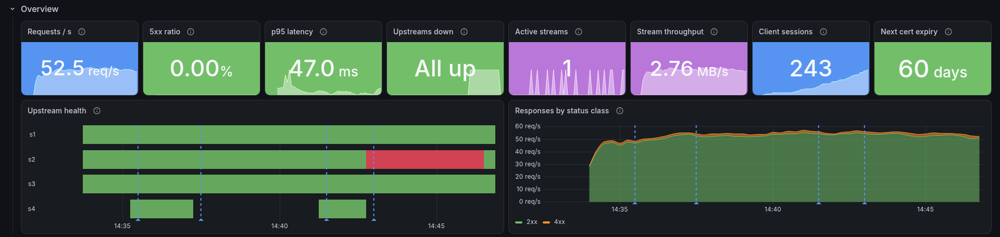

# jellyfin-merge-proxy

An HTTP proxy that puts several upstream **Jellyfin** servers behind one
virtual Jellyfin server. Jellyfin clients connect to the proxy, log in with a
proxy account, and see the libraries of all upstreams together: libraries with
the same name and type are merged, lists are fetched from every upstream,
merged, sorted and re-paged, and playback is proxied to whichever server owns
the item.

Written in Rust (stable, edition 2021): tokio, axum, reqwest, serde, toml,
rustls (no OpenSSL), tracing, metrics + Prometheus exporter.

> **Status / honesty note.** The proxy implements the subset of the Jellyfin
> HTTP API that browsing and playback rely on, and it is tested against mock
> upstreams in `tests/e2e.rs`. It has **not** been verified against real
> Jellyfin servers or real client apps (Android TV, Fire TV, webOS, Tizen,
> Swiftfin, Jellyfin Media Player, Kodi, ...). Expect rough edges. See
> [Limitations](#limitations).

## Contents

- [How it works](#how-it-works)
- [Quick start (Docker)](#quick-start-docker)
- [Unraid](#unraid)
- [Running without Docker](#running-without-docker)
- [Adding the server in a TV / client app](#adding-the-server-in-a-tv--client-app)
- [Configuration](#configuration)
- [Proxy user passwords (argon2id)](#proxy-user-passwords-argon2id)
- [TLS](#tls)
- [Logging](#logging)
- [Metrics](#metrics)
- [Debug endpoint](#debug-endpoint)
- [Hot reload](#hot-reload)
- [API surface](#api-surface)
- [Architecture](#architecture)
- [Development](#development)
- [Testing against real Jellyfin servers](#testing-against-real-jellyfin-servers)
- [Limitations](#limitations)

## How it works

```
 Jellyfin client ──► jellyfin-merge-proxy ──┬──► upstream "home"   (Jellyfin)
   (proxy login)       one server id         ├──► upstream "friend" (Jellyfin)
                       merged libraries      └──► ...
```

* **Proxy accounts.** Clients authenticate against `[[user]]` entries in the
  config, not against any upstream. The proxy issues its own access tokens.
* **Upstream accounts.** Each `[[server]]` is accessed with one configured
  account (API key or username/password). Logins are lazy, cached, retried on
  401, and an unreachable upstream is skipped (its content just disappears
  until it comes back).
* **IDs.** Every id an upstream returns (items, views, users, sessions, ...)
  is rewritten, recursively through the JSON, to a proxy id:
  `hex(sha256("jmp1:" + upstream name + ":" + upstream id))[..32]`. The
  mapping is kept in a lookup table persisted to `data_dir/ids.tsv`, so a
  proxy id always routes back to the owning upstream and original id. Ids in
  request paths, query strings and JSON bodies are translated back.
* **Libraries.** Upstream views are grouped by (name, collection type) when
  `merge_libraries_by_name = true`; a merged view gets its own stable id and
  queries against it fan out to the member libraries.
* **Lists.** `/Items`, `Latest`, `Resume`, `NextUp`, search hints, genres,
  persons, ... fan out to all relevant upstreams with
  `StartIndex=0&Limit=min(StartIndex+Limit, fanout_limit)`, then the proxy
  merges, optionally de-duplicates (Tmdb/Imdb/Tvdb provider ids), sorts by the
  requested `SortBy`/`SortOrder` and applies the client's paging.
  Upstreams are always asked for `ProviderIds` when dedupe applies.
* **Shows split across servers.** With `dedupe`, a series on several servers
  is listed once, and its other copies are remembered as *siblings*
  (`data_dir/siblings.tsv`). Its seasons and episodes (`/Shows/{id}/Seasons`,
  `/Shows/{id}/Episodes`, `/Items?ParentId=`) fan out to every copy and merge
  by season / episode number, so S01 from one server and S02 from another
  browse as one show. Each episode still plays from (and records watch state
  on) the server that has it.
* **Playback.** `PlaybackInfo`, direct streams, HLS playlists and segments,
  images, subtitles and playstate reports go to the owning upstream. Response
  bodies are streamed through without buffering, `Range` is passed through,
  HLS playlists are rewritten so segment URLs point back at the proxy, and
  upstream tokens in `PlaybackInfo` URLs are replaced with the client's proxy
  token.

## Quick start (Docker)

```sh
# Create config file FIRST on the host (Docker creates a directory if file doesn't exist)
touch jmp.toml
cp config.example.toml jmp.toml
$EDITOR jmp.toml                     # set [[user]] and [[server]] entries

# Make it writable by container user (uid 65532)
chown 65532:65532 jmp.toml           # or use your --user uid if different

# Create and set permissions on data directory
mkdir -p data
sudo chown -R 65532:65532 data       # the image runs as uid 65532 (nonroot) by default

docker compose up -d --build
docker compose logs -f
```

**Important**:
- Config file (`jmp.toml`) must be created **before** starting the container
- Config must be **read-write** (not `:ro`) for automatic secret encryption
- Data directory (`/var/lib/jmp`) holds the encryption key (`secret.key`) with mode 0600
- For arbitrary uid (e.g., Unraid `--user 99:100`), chown the data volume first:
  ```sh
  docker run --rm -v jmp-data:/data alpine chown -R 99:100 /data
  ```

The image runs as any uid (`--user 99:100`, compose `user:`) and writes to
`/var/lib/jmp` for data (id map, sessions, catalog cache, auto-generated secret
key). Config is at `/etc/jmp.toml` (bind-mounted). If the path is a directory
(Docker creates one when bind-mounting a missing file), the container prints a
clear error with fix instructions. No certificates are needed: plain HTTP is the default,
and TLS inbound (`[tls]`) or to upstreams (`[server.tls]`) is opt-in.

## Installation

### Pre-built Docker Images

Official images are published to GitHub Container Registry (GHCR) for amd64 and arm64:

```bash
docker pull ghcr.io/quyzi/jellyfin-merge-proxy:latest
```

Available tags:
- `latest` - Latest stable release
- `X.Y.Z` - Specific version (e.g., `0.1.0`)
- `X.Y` - Latest patch version (e.g., `0.1`)

See [docker-compose.yml](docker-compose.yml) for a complete Docker Compose setup.

### Debian / Ubuntu (.deb)

```bash
# Download the .deb for your architecture
wget https://github.com/Quyzi/jellyfin-merge-proxy/releases/latest/download/jellyfin-merge-proxy_<version>_amd64.deb

# Install
sudo dpkg -i jellyfin-merge-proxy_<version>_amd64.deb

# Create and edit config
sudo nano /etc/jmp.toml

# Start the service
sudo systemctl start jellyfin-merge-proxy
sudo systemctl enable jellyfin-merge-proxy

# Check status
sudo systemctl status jellyfin-merge-proxy
sudo journalctl -u jellyfin-merge-proxy -f
```

The .deb package:
- Installs the binary to `/usr/bin/jellyfin-merge-proxy`
- Creates a dedicated `jmp` system user
- Sets up a systemd service with hardening
- Creates `/var/lib/jmp` for data (id map, sessions, cache, secret key)
- Installs the example config to `/etc/jmp.toml` (not overwritten on upgrade)

### RHEL / Fedora / CentOS (.rpm)

```bash
# Download the .rpm for your architecture
wget https://github.com/Quyzi/jellyfin-merge-proxy/releases/latest/download/jellyfin-merge-proxy-<version>-1.x86_64.rpm

# Install
sudo rpm -i jellyfin-merge-proxy-<version>-1.x86_64.rpm

# Create and edit config
sudo nano /etc/jmp.toml

# Start the service
sudo systemctl start jellyfin-merge-proxy
sudo systemctl enable jellyfin-merge-proxy

# Check status
sudo systemctl status jellyfin-merge-proxy
sudo journalctl -u jellyfin-merge-proxy -f
```

### Binary Tarballs

Pre-built binaries are available for:
- `x86_64-unknown-linux-gnu` (glibc-based systems)
- `aarch64-unknown-linux-gnu` (ARM64 glibc)
- `x86_64-unknown-linux-musl` (static, no libc)
- `aarch64-unknown-linux-musl` (ARM64 static)

```bash
# Download and extract
wget https://github.com/Quyzi/jellyfin-merge-proxy/releases/latest/download/jellyfin-merge-proxy-<version>-x86_64-unknown-linux-gnu.tar.gz
tar xzf jellyfin-merge-proxy-<version>-x86_64-unknown-linux-gnu.tar.gz
cd jellyfin-merge-proxy-<version>-x86_64-unknown-linux-gnu

# Copy example config
cp config.example.toml jmp.toml
$EDITOR jmp.toml

# Run
./jellyfin-merge-proxy
```

The image is a multi-stage build on Chainguard images
(`cgr.dev/chainguard/rust` → `cgr.dev/chainguard/glibc-dynamic`): no shell,
non-root, rustls/aws-lc-rs for TLS. `JMP_CONFIG=/etc/jmp.toml`, port
`8096`. `docker-compose.yml` bind-mounts `./jmp.toml` to `/etc/jmp.toml` and
a volume for `/var/lib/jmp` (data), with commented mounts for certificates
(`./certs:/config/certs:ro`) and an optional Prometheus service
(`deploy/prometheus.yml`). Pass `JMP_GIT_SHA=$(git rev-parse --short HEAD)`
to stamp the build. Auto-generated secret key (for upstream secret encryption) is
`/var/lib/jmp/secret.key`; override via `JMP_SECRET_KEY` env (64 hex characters).

There is no `HEALTHCHECK` in the image (no shell/curl in the runtime image);
probe `GET /System/Ping` or `/metrics` from your orchestrator instead.

## Unraid

[`unraid/jellyfin-merge-proxy.xml`](unraid/jellyfin-merge-proxy.xml) is a
Community Applications template (bridge network, port 8096, config file at
`/mnt/user/appdata/jellyfin-merge-proxy/jmp.toml` bind-mounted to `/etc/jmp.toml`,
data directory at `/mnt/user/appdata/jellyfin-merge-proxy/data` mounted to
`/var/lib/jmp`, `--user 99:100`, an optional certificates path that is never
required). The image name in it is a placeholder (`ghcr.io/OWNER/...`). Install
steps, first-run config and TV setup: [`unraid/README.md`](unraid/README.md). The
XML is checked with `xmllint --noout unraid/jellyfin-merge-proxy.xml`.
**IMPORTANT**: Back up `/var/lib/jmp/secret.key`; losing it means re-entering all
upstream passwords and API keys.

## Running without Docker

```sh
cargo build --release
./target/release/jellyfin-merge-proxy ./jmp.toml               # positional path
./target/release/jellyfin-merge-proxy --config ./jmp.toml      # or -c
JMP_CONFIG=./jmp.toml ./target/release/jellyfin-merge-proxy
./target/release/jellyfin-merge-proxy                          # /etc/jmp.toml
```

Other flags: `-h/--help`, `-V/--version` (version + git sha),
`--metrics-md` (print the metric reference, used to generate `METRICS.md`).
Signals: `SIGHUP` reloads the config, `SIGINT`/`SIGTERM` shut down gracefully
(in-flight requests get up to 10 s). Secret key: set `JMP_SECRET_KEY` env (64 hex)
or let it auto-generate `/var/lib/jmp/secret.key` (default `data_dir`).

## Adding the server in a TV / client app

1. Run the proxy somewhere the TV can reach, e.g. on a home server at
   `192.168.1.5`, listening on `0.0.0.0:8096` (the default Jellyfin port).
2. In the Jellyfin client choose **Add server / Change server** and enter
   `http://192.168.1.5:8096` (or `https://your.host:8096` if `[tls]` is
   enabled and the TV trusts the certificate; TV apps generally do not let
   you add custom CAs, so use a publicly trusted certificate for HTTPS).
3. The app calls `/System/Info/Public` and shows the server under
   `[proxy].name`.
4. Log in with **a `[[user]]` from the proxy config** – not an upstream
   account. The proxy reports no public users (`/Users/Public` is `[]`) and
   Quick Connect as disabled, so the app shows a manual username/password form.
5. The home screen shows the merged libraries; playback is routed to the
   server that holds the item.

Automatic LAN discovery (UDP 7359) is not implemented; enter the address
manually. Keep `[proxy].id` stable: clients remember servers by id.

The proxy accepts the client token in every form Jellyfin clients use:
`Authorization: MediaBrowser ..., Token="..."`, `X-Emby-Authorization`,
`X-Emby-Token`, `X-MediaBrowser-Token`, and `?api_key=` / `?ApiKey=`.

## Configuration

Config path: first CLI argument (`-c/--config <path>` or a positional path),
else `$JMP_CONFIG`, else `/etc/jmp.toml`. The full, commented example is
[`config.example.toml`](config.example.toml). Upstreams are written like this:

```toml
[[server]]
name = "gummybear"
server = "https://some-domain:8493"
user = "gummybear"
password = "meow"
```

Sections:

| Section | Keys |
|---|---|
| `[proxy]` | `listen`, `name`, `id` (32 hex, optional), `reported_version`, `data_dir` (default `/var/lib/jmp`), `unknown_routes` (`primary`\|`empty`), `upstream_timeout_secs`, `reload_interval_secs` (default 3), `drain_timeout_secs` (default 300), `rewrite_secrets` (default true) |
| `[[user]]` | `name`, `password` (plaintext, `{ plain = ".." }`, `{ argon2 = ".." }` or a bare `$argon2id$...` string) |
| `[[server]]` (alias `[[upstream]]`) | `name`, `server` (base URL, sub-path allowed), `user` + `password`, or `api_key` (+ `user` or `user_id`), `priority` (lower wins in dedupe; default = position), `enabled`, optional `[server.tls]` |
| `[merge]` | `merge_libraries_by_name`, `dedupe`, `dedupe_types`, `label_colliding_libraries`, `fanout_limit` |
| `[cache]` | `enabled`, `ttl_secs`, `refresh_interval_secs`, `max_entries`, `serve_stale_on_error`, `persist_path` |
| `[tls]` | `cert_path`, `key_path`, `min_version`, `client_auth`, `client_ca_path`, `http2`, `redirect_http_listen` |
| `[upstream_tls]` | defaults for all upstreams: `ca_path`, `insecure_skip_verify`, `client_cert_path`, `client_key_path`, `min_version`, `server_name` |
| `[logging]` | `filter`, `format` (`pretty`\|`compact`\|`json`), `ansi` |
| `[metrics]` | `enabled`, `path`, `listen`, `require_auth`, `process_metrics` |
| `[debug]` | `enabled` (default false), `path`, `users` |

The first enabled upstream is the **primary**: it receives unknown routes
(when `unknown_routes = "primary"`) and serves `/web`.

With an `api_key`, the proxy needs to know which upstream user's library and
watch state to use: set `user_id`, or `user` (looked up via the API). If neither resolves a
user, a warning is logged and user-scoped calls to that upstream will fail.

## Proxy user passwords (argon2id)

* Plaintext `[[user]]` passwords are hashed with **argon2id** (random salt,
  argon2 crate defaults) when the config is loaded and on every reload. Only
  the resulting `HashedPassword` (a PHC string newtype) is kept; login
  verification uses it exclusively and runs on a blocking thread.
* Values that already are argon2 PHC strings are validated (a malformed hash
  is a config error) and used as-is.
* Hashes are cached so an unchanged entry is not re-hashed on each reload.
  The cache key is a SHA-256 over a random per-process key, the user name and
  the plaintext; the plaintext itself is not stored.
* The plaintext buffers are zeroized after hashing, and the password type's
  `Debug` prints `<redacted>`.
* **When `rewrite_secrets = true` (default)**, plaintext passwords are replaced
  in the config file with the argon2 hash after a successful load, so plaintext
  never stays on disk. If you don't want this, set `rewrite_secrets = false`.
  To pre-hash: `echo -n 'secret' | argon2 "$(openssl rand -hex 8)" -id -e`.

## Upstream secret encryption

* **When `rewrite_secrets = true` (default)**, upstream `password` and `api_key`
  values that are plaintext are encrypted with **XChaCha20-Poly1305** (authenticated
  encryption) and written back to the config file as `enc:v1:<base64>`.
* The encryption key (256-bit) is loaded from:
  1. `JMP_SECRET_KEY` env var (64 hex characters), or
  2. `<data_dir>/secret.key` file (auto-generated if missing, 0600 permissions).
* **BACK UP THE SECRET KEY**: losing it (or env var) means re-entering all upstream
  passwords and API keys. The key file is logged on first generation.
* Plaintext is still accepted (that's how users enter secrets); already-encrypted
  values (`enc:v1:...`) are left untouched and decrypted on load.
* Decryption failures (wrong key, corrupted data) are logged per-upstream and
  counted in `jmp_secret_decrypt_failures_total`; that upstream is skipped.

## TLS

rustls only (aws-lc-rs provider); OpenSSL is not linked.

**Inbound (`[tls]`).** Without the section the proxy serves plain HTTP.
With it:

* `cert_path` (chain, leaf first) and `key_path` (PKCS#8, PKCS#1/RSA or
  SEC1/EC PEM). The key is checked against the certificate.
* `min_version = "1.2" | "1.3"`.
* `client_auth = "none" | "optional" | "required"` with `client_ca_path`
  for mTLS.
* `http2 = true` offers `h2` and `http/1.1` via ALPN; `false` = HTTP/1.1 only.
* `redirect_http_listen` adds a plain-HTTP listener answering
  `308 → https://<host>:<tls port><path>`.
* The cert/key/CA files are watched (see [Hot reload](#hot-reload)) and
  swapped via axum-server without dropping the listener. Invalid new material
  (unparsable, key mismatch, ...) is rejected and the old certificate keeps
  serving.

**Outbound (`[upstream_tls]` + per-server `[server.tls]`).** Per-upstream
values override the global ones field by field:

* `ca_path` adds a CA to the system roots (for self-signed / internal CAs).
* `client_cert_path` + `client_key_path` for mTLS to the upstream.
* `min_version`.
* `server_name` verifies the upstream certificate against this name instead
  of the URL host. Note: the SNI sent is still the URL host (see Limitations).
* `insecure_skip_verify = false` by default; when true, certificate
  verification is disabled and a loud `WARN` is logged at every (re)build.

Each upstream gets its own reqwest client built from its effective TLS
settings; clients are rebuilt on reload. All TLS settings are validated on
load and reload; on error the previous configuration stays in effect.

Certificate `notAfter` dates are exported as
`jmp_tls_cert_expiry_timestamp_seconds{cert="listener"|"client_ca"|"upstream:<name>"...}`.

## Logging

`tracing` + `tracing-subscriber` with an `EnvFilter`:

* `[logging].filter` (default `info`), hot-reloadable; `RUST_LOG`, when set,
  overrides it (and then config reloads don't touch the filter).
* `format = "pretty" | "compact" | "json"`, `ansi` – need a restart.
* Every request runs in an `http` span with `method`, `route` (bounded route
  template, not the raw path), `request_id`, then `status` and latency on
  completion. `X-Request-Id` is propagated from the client if present (or
  generated) and echoed in the response.
* Key functions (`fan_list`, upstream `request`/`login`, `reload`, `login`,
  ...) are `#[instrument]`ed with secrets skipped; pipeline stages emit
  `stage` trace events matching `jmp_stage_duration_seconds`.
* **Secrets are never logged.** Passwords, tokens, API keys and
  `Authorization`-style headers are not put in log fields, query strings are
  not logged, and every secret-bearing type (`Secret`, `HashedPassword`,
  `Session`, `ProxyUser`, upstream auth state) has a redacting `Debug`.

## Metrics

`metrics` crate + `metrics-exporter-prometheus`. Config:

```toml
[metrics]
enabled = true
path = "/metrics"
# listen = "0.0.0.0:9090"  # separate plain-HTTP port (then not served on the main port)
require_auth = false       # true: requires a proxy token (any accepted token form)
process_metrics = true
```

The full list (≈90 metrics) is in **[METRICS.md](METRICS.md)**, generated from
the single source of truth in `src/telemetry.rs` (`telemetry::names` +
`telemetry::METRICS`) with `jellyfin-merge-proxy --metrics-md > METRICS.md`;
a unit test fails if the file is out of date. Families:

* HTTP: requests, duration, in-flight, response size, errors by kind,
  per-stage durations (`auth`, `id_decode`, `fanout`, `rewrite`, `dedupe`,
  `sort_page`, `serialize`, `views_build`, ...).
* Fan-out: upstreams queried, per-upstream outcome, partial results, slowest
  upstream wait.
* IDs, merge/dedupe (dropped by key, winner server), library groups.
* Views cache: hits/misses/stale, evictions, entries, bytes, refresh duration,
  failures, last success; ids/sessions persistence ops.
* Upstream client (via an `Instrumented<T: Transport>` decorator around the
  HTTP transport): in-flight, duration, status class, error kind
  (connect/dns/tls/timeout/body), retries, re-auth, logins, token age, up.
* Auth: active sessions, logins by outcome, token validations, argon2 time.
* Streaming: active streams by server/kind, bytes, TTFB, end outcome
  (complete/client_disconnect/upstream_error), Range requests, HLS playlist
  rewrites and segments.
* Config/TLS: reloads by outcome, last reload time, generation, upstream/user
  counts, upstream add/remove/change, TLS reloads, cert expiry.
* Runtime: `jmp_build_info{version,git_sha}`, uptime, tokio workers / alive
  tasks / global queue depth, `process_*` metrics.

Labels are bounded: routes are templated (`/items/{id}/images/{x}`, unknown
paths → `/other`), servers are config names, ids and tokens never appear in
labels.

### Observability Stack



More screenshots of every row are in [docs/dashboard.md](docs/dashboard.md).

`docker-compose.yml` also starts Prometheus and Grafana, provisioned with the
dashboard and alert rules:

```sh
cp .env.example .env     # set GRAFANA_ADMIN_PASSWORD
docker compose up -d     # proxy :8096, Prometheus :9090, Grafana :3000
```

Grafana logs in with `GRAFANA_ADMIN_USER` / `GRAFANA_ADMIN_PASSWORD` from `.env`
(default `admin` / `changeme`) and opens the **Jellyfin Merge Proxy** dashboard
(`deploy/grafana-dashboard.json`, also importable into an existing Grafana). It
has 55 panels in 10 rows (overview stats with sparklines, upstream health state
timeline, latency heatmaps, per-upstream bar gauges and summary tables, stacked
pipeline stages, streaming, merge/dedupe, cache, auth, config/TLS with a
certificate expiry table, process) and `datasource`, `instance` and `server`
variables. Config reloads and TLS reloads are annotated.

The dashboard JSON is generated from `xtask/src/dashboard/` by
`cargo xtask dashboard`, and `cargo test` fails if it is stale or references a
metric or label the proxy does not export. See `DASHBOARD_TESTING.md`.

Prometheus alerting rules in **`deploy/prometheus/alerts.yml`** cover: proxy not
scraped, upstream down, no healthy upstreams, 5xx ratio > 5 %, upstream p95 > 5 s,
TLS certificates expiring (< 14 days warning, < 7 days critical), failed config
reloads, a high stream disconnect ratio and a low cache hit ratio.

## Debug endpoint

```toml
[debug]
enabled = true          # default false: the route does not exist
path = "/jmp/debug"
users = ["chris"]       # optional allow-list of proxy users
```

`GET /jmp/debug` requires a proxy login token (401 without, 403 if the user
isn't allowed) and returns JSON with version/git sha/uptime, config
generation/path/last reload result, merge and TLS settings, per-upstream
status (up, auth state, token age, TLS summary), id table sizes, views cache
state, **redacted** sessions (token fingerprint = first 4 bytes of its SHA-256,
user, client, device, version, created) and active streams. No tokens,
passwords or API keys are included (asserted in the e2e test).

## Hot reload

The config file and every certificate/key/CA file it references are polled
every `reload_interval_secs` (default 3; `0` = only on `SIGHUP`). A file
counts as changed when its modification time or size changes. A reload:

1. parses and validates the whole new config, including building every TLS
   config and constructing (not yet logging in) every new or changed
   `[[server]]`; on any error it logs it, counts
   `jmp_config_reloads_total{outcome="error"}` and **keeps the previous config**;
2. diffs the `[[server]]` list by `name` (case-insensitive) and applies it:
   * **added** server: built through the `BackendFactory`, logged in in the
     background, and its libraries show up in `UserViews` and merged lists on
     the next request (merged by name with existing libraries as usual);
   * **removed** server (block deleted or `enabled = false`): disappears from
     views and lists at once; requests already running on it finish (it is
     *drained* for up to `drain_timeout_secs`, default 300), then its
     upstream session is ended (`POST /Sessions/Logout` for `user`/`password`
     logins; API keys are never logged out, since that would revoke them).
     Its catalog-cache entries are purged. Proxy ids that pointed at it
     answer **410 Gone**; if the server is added back under the same name,
     those ids work again;
   * **`server` URL changed**: the backend is rebuilt (new client and login)
     under the same id, so every proxy id stays valid (ids hash the server
     *name*, not its URL); the old backend drains as above;
   * other per-server changes (credentials, `[server.tls]`, timeouts) are
     applied in place;
   * the new server set is swapped in atomically: a request uses the set it
     started with, never a half-updated one;
3. applies users (existing sessions of remaining users survive), merge
   settings (clearing the views cache), the log filter and the listener
   certificate.

Renaming a server is a remove plus an add: the old name's ids answer 410 and
the new name gets new ids. A reload that would leave no enabled server, or
duplicate names, is rejected.

Changes that still need a restart (logged as a warning): `[proxy] listen`,
`data_dir`, `name`/`id` (the server id clients see), turning `[tls]` on/off or
changing its redirect port, `[metrics]` listen/path/enabled, `[debug]`
path/enabled, `[cache] enabled`/`persist_path`, `[logging] format`/`ansi`.

Metrics: `jmp_config_upstream_changes_total{change="added|removed|rebuilt|changed"}`,
`jmp_servers_active`, `jmp_servers_draining`,
`jmp_upstream_configured` (1 while a `[[server]]` is enabled, 0 once removed or disabled),
`jmp_servers_retired_total{outcome="drained|timeout"}`,
`jmp_server_drain_duration_seconds`, `jmp_removed_server_requests_total`.

## API surface

Answered by the proxy itself:

| Endpoint | Behaviour |
|---|---|
| `GET /System/Info/Public`, `/System/Info`, `/System/Ping`, `/System/Endpoint` | proxy identity (`[proxy].name`, id, `reported_version`) |
| `GET /Branding/Configuration`, `/Branding/Css` | empty branding |
| `GET /QuickConnect/Enabled` | `false` |
| `GET /Users/Public` | `[]` |
| `POST /Users/AuthenticateByName` | checks `[[user]]`, returns a full `AuthenticationResult` (User, SessionInfo, AccessToken, ServerId) |
| `GET /Users/Me`, `/Users/{id}`, `/Users` | proxy user DTO |
| `GET /UserViews`, `/Users/{u}/Views` | merged libraries |
| `GET /Items/{view}`, `/Users/{u}/Items/{view}`, view images | merged view DTO / primary image of a member library |
| `GET /Items`, `/Users/{u}/Items` | fan-out (or routed to the owning upstream for `ParentId`), merge, dedupe, sort, page |
| `GET /Items/Latest`, `/UserItems/Resume`, `/Shows/NextUp`, `/Search/Hints`, `/Genres`, `/Studios`, `/Persons`, `/Artists`, ... | fan-out lists |
| `GET /Shows/{id}/Seasons`, `/Shows/{id}/Episodes` | for a series that is on several servers (with `dedupe`): fan-out to every copy, seasons merged by number, episodes by season+episode number (priority winner kept); otherwise routed to the owner |
| `GET /Items/Filters(2)`, `/Items/Counts` | merged objects |
| `GET/POST /Sessions*`, `/Sessions/Playing/Ping`, `/DisplayPreferences/{id}`, `/SyncPlay/*`, `/Plugins`, ... | local stubs |
| `/socket` | WebSocket keep-alive only |

Routed to the owning upstream by the proxy id in the path/query/body:
`/Items/{id}`, `/Users/{u}/Items/{id}`, `/Shows/{id}/Seasons|Episodes` (single-server series),
`/Items/{id}/Images/*`, `/Items/{id}/PlaybackInfo`, `/Videos/{id}/*`,
`/Audio/{id}/*` (direct and HLS: `master.m3u8`, `main.m3u8`, segments;
playlists rewritten), subtitles, `/Sessions/Playing{,/Progress,/Stopped}`
(routed by `ItemId`), `/UserPlayedItems/{id}`, `/UserFavoriteItems/{id}`, and
legacy `/Users/{u}/...` forms (translated). Anything else without a known id
goes to the primary upstream or returns empty, per `unknown_routes`, and is
logged at debug with its route template.

## Architecture

The code is organised around small traits (media backend, credentials,
proxy authenticator, id mapper, merge strategy, deduplicator, catalog
cache, config source/watcher, reloadable components, TLS provider,
response rewriter chain, endpoint registry) with metrics added by
decorators. See [ARCHITECTURE.md](ARCHITECTURE.md).

A config written for an older build with `[server]` (single brackets) for the
proxy section is rejected with a hint to rename it to `[proxy]`.

## Development

```sh
cargo build --release
cargo test                 # 42 unit + 4 end-to-end (mock HTTP upstreams, rcgen PKI) + 1 MockBackend + 2 hot-reload + 3 real-Jellyfin regression tests
cargo clippy --all-targets -- -D warnings
cargo fmt
cargo run -q -- --metrics-md > METRICS.md   # after changing telemetry::METRICS
```

### Releasing

Releases are automated via GitHub Actions. To cut a new release:

1. **Update the version** in `Cargo.toml`:
   ```sh
   # Edit Cargo.toml and set version = "X.Y.Z"
   vim Cargo.toml
   ```

2. **Commit and push**:
   ```sh
   git add Cargo.toml
   git commit -m "chore: bump version to X.Y.Z"
   git push origin master
   ```

3. **Tag and push the release**:
   ```sh
   git tag release/vX.Y.Z
   git push origin release/vX.Y.Z
   ```

The release workflow (`.github/workflows/release.yml`) automatically:
- Validates the tag matches `Cargo.toml` version
- Runs fmt, clippy, and tests
- Builds multi-arch binaries (x86_64, aarch64, gnu, musl) with tarballs + SHA256 checksums
- Builds .deb and .rpm packages for both architectures
- Builds and pushes multi-arch Docker images to `ghcr.io/quyzi/jellyfin-merge-proxy`
  - Tagged with version, major.minor, and `latest` (for stable releases only)
  - Includes provenance, SBOM, and cosign keyless signatures
- Creates a GitHub Release with:
  - Auto-generated release notes from git log
  - All binaries, packages, and checksums attached
  - Marked as prerelease if version contains `-rc`, `-alpha`, or `-beta`

Check [Actions](https://github.com/Quyzi/jellyfin-merge-proxy/actions) for build status.

Local package testing:
```sh
# Build and inspect packages
cargo install cargo-deb cargo-generate-rpm
cargo build --release
cargo deb --no-build
dpkg -c target/debian/jellyfin-merge-proxy_*.deb

cargo generate-rpm
# (rpm -qlp requires rpm tools)
```

### Dependabot Automation

The repository includes Dependabot configuration (`.github/dependabot.yml`) for automated dependency updates:
- **Cargo dependencies**: Weekly updates, grouped by minor/patch
- **GitHub Actions**: Weekly updates, grouped
- **Docker base images**: Weekly updates for Chainguard images

Dependabot PRs are automatically merged for:
- Patch and minor semver updates (after CI passes)
- GitHub Actions updates
- Docker digest updates

Major version updates require manual review.

**Required repository settings** (owner must enable):
1. **Settings → General → Pull Requests**:
   - ✅ Allow auto-merge
2. **Settings → Branches** (for `master`):
   - ✅ Require status checks to pass before merging
   - ✅ Require branches to be up to date before merging
   - Required checks: `fmt`, `clippy`, `test`, `audit`, `docker`
3. **Settings → Code security and analysis**:
   - ✅ Dependabot security updates

Without these settings, Dependabot will still create PRs, but auto-merge won't work.

Layout (details and the trait list in [ARCHITECTURE.md](ARCHITECTURE.md)):
`src/config.rs` (TOML, secrets, validation), `src/types.rs` / `src/error.rs`
(id newtypes, thiserror errors), `src/backend/` (`MediaBackend`, Jellyfin and
mock backends, credentials, transport), `src/endpoints/` (route registry and
handlers), `src/proxy.rs` (shared handler logic, fan-out, relay),
`src/ids.rs` (`IdMapper`), `src/rewrite.rs` (`ResponseRewriter` chain),
`src/merge.rs` (`MergeStrategy`, `Deduplicator`, sorting), `src/cache.rs`
(`CatalogCache`), `src/users.rs` / `src/password.rs` (proxy logins, argon2),
`src/reload.rs` (`ConfigSource`, `ConfigWatcher`, `Reloadable`, `ReloadHub`),
`src/tls.rs` (`TlsProvider`), `src/server.rs` (listeners), `src/auth.rs`
(client tokens, sessions), `src/telemetry.rs` (metrics, logging), `src/paths.rs`, `src/dto.rs`.

## Testing against real Jellyfin servers

`scripts/real-jellyfin/start-servers.sh` starts three real Jellyfin
containers with generated H.264/AAC media (unique and duplicated titles, a
show split across two servers, an HTTPS server with a private CA), and
`scripts/real-jellyfin-test.sh` drives the proxy like a client through
login, browsing, playback (direct stream with Range, HLS checked with
ffprobe, subtitles), user data (verified on the owning upstream) and eleven
config scenarios (merge/dedupe/priority, server down and back, API key
upstream, HTTPS upstream, TLS listener, hot reload, cache, `unknown_routes`).
Set `JMP_IMAGE` to run the proxy from the container image instead of the
binary. Details: [`scripts/real-jellyfin/README.md`](scripts/real-jellyfin/README.md).
Bugs it found have regression tests in `tests/real_jellyfin_regressions.rs`.

## Limitations

* **Tested against real Jellyfin servers, not real client apps.** The
  real-server suite (Jellyfin 12.3.0) issues the HTTP calls a client makes
  with curl; no TV, phone or desktop app has been tried, so no
  client-compatibility claims are made.
* **Shared upstream identity.** All proxy users use the same upstream
  account per server, so watch state, favourites, resume points and parental
  controls are shared between proxy users.
* **Per-upstream non-item ids.** Genres, persons, studios etc. are
  per-upstream; the same genre on two servers appears twice in lists and
  filtering by it only queries one server.
* **Dedupe** applies only to fan-out lists, matches by Tmdb/Imdb/Tvdb (plus
  name for genre/person-style lists), and makes `TotalRecordCount`/paging
  approximate. Deep paging is bounded by `fanout_limit`.
* **Split shows:** watch state stays per server, so `NextUp` for a show
  split across servers can list one next episode per server. A series that
  never appeared in a merged list is looked up on the other servers (by
  provider id and production year) the first time its seasons/episodes are
  opened.
* **Sorting** of merged lists is done in the proxy from the returned item
  JSON (`SortName`, `PremiereDate`, `DateCreated`, `CommunityRating`,
  `UserData` fields, ...). Items lacking the field sort last, and sort keys
  whose value isn't in the DTO can order differently than Jellyfin would.
* **Merged view ids** are derived deterministically but not stored; they are
  rebuilt from upstream views on demand.
* **WebSocket** only answers keep-alives; no remote control, no server-pushed
  library/playstate updates.
* **No** SyncPlay, Live TV, admin dashboard, user management, Quick Connect,
  or LAN discovery. `/web` is forwarded to the primary upstream's web client;
  its index and bundles load through the proxy, but using it interactively
  has not been tested.
* **Transcoding** happens on the owning upstream with its settings; the proxy
  does not transcode.
* `server_name` override verifies the upstream cert against that name but the
  TLS SNI is still the URL host.
* Inbound TLS handshake failures are not metered (they happen below the HTTP
  layer).
* The settings listed at the end of [Hot reload](#hot-reload) need a restart;
  adding, removing and re-pointing `[[server]]`s does not.
* The image has been built and run with podman 5.4 (including as uid
  99:100), not with Docker Engine, and the Unraid template has not been
  installed on a real Unraid host.
