# Grafana dashboard

Screenshots of the **Jellyfin Merge Proxy** dashboard (`deploy/grafana-dashboard.json`),
captured on a lab setup: the proxy in front of three real Jellyfin servers
(`s1`–`s3`, plus `s4` added and removed by hot reload), with about 20 minutes of
generated traffic covering logins, browsing, Range and HLS streaming, config
reloads, a broken config, one upstream stopped for a few minutes and a TLS
certificate reload. See [DASHBOARD_TESTING.md](../DASHBOARD_TESTING.md) for how
to reproduce it.

## Overview

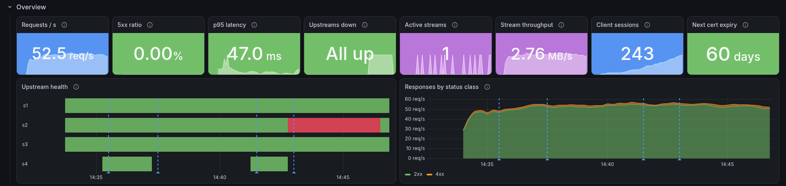

## Client traffic

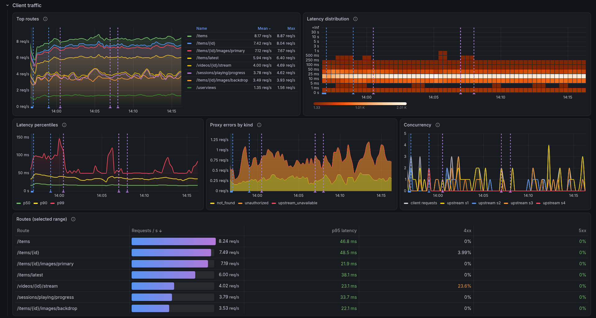

## Upstream servers

`s4` was removed from the config by a hot reload, so it shows as **REMOVED**
rather than down.

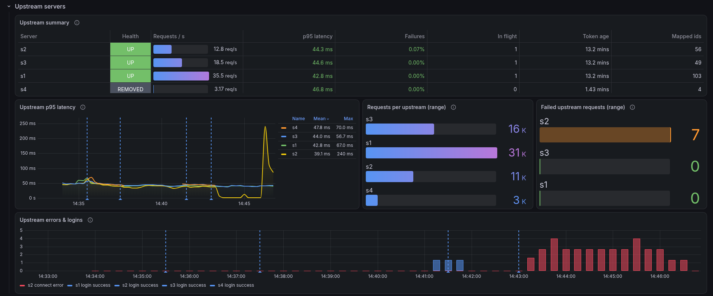

## Request pipeline

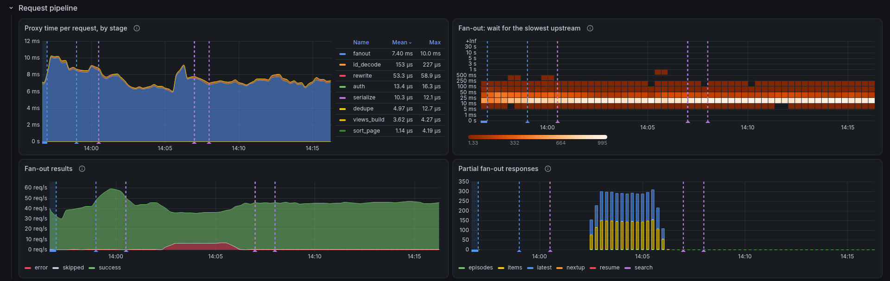

## Streaming

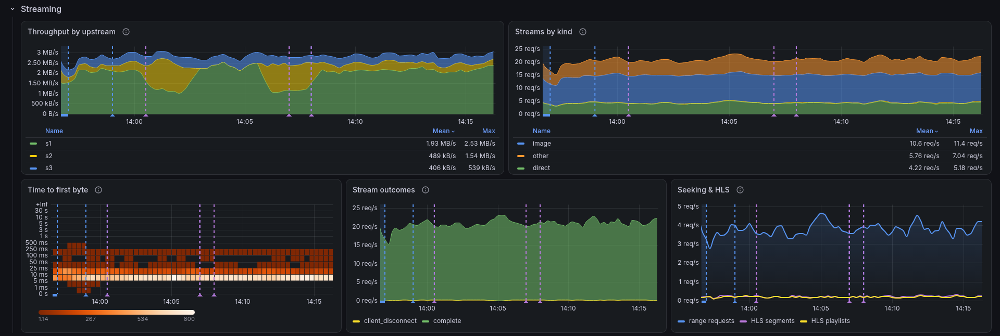

## Merge, dedupe and IDs

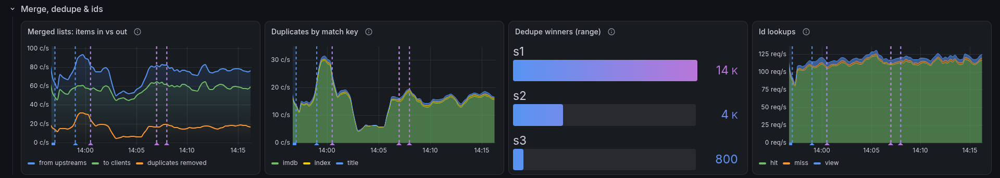

## Catalog cache

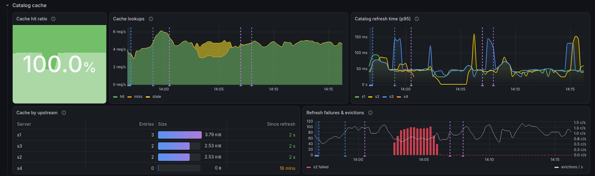

## Clients and auth

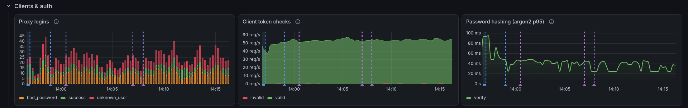

## Configuration and TLS

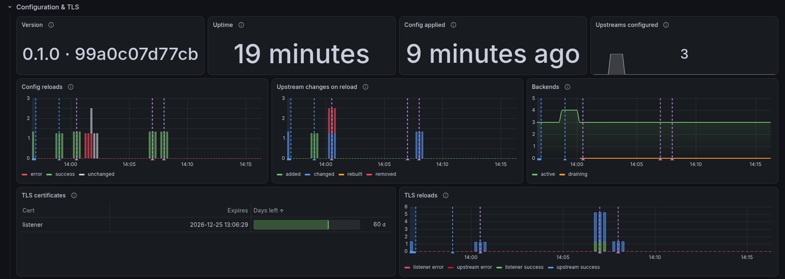

## Process

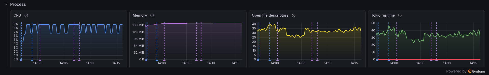

## Full dashboard

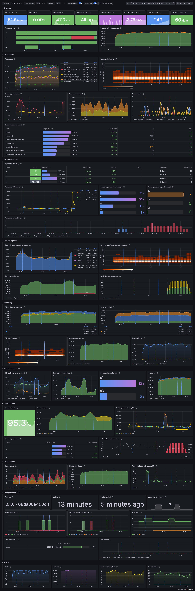
